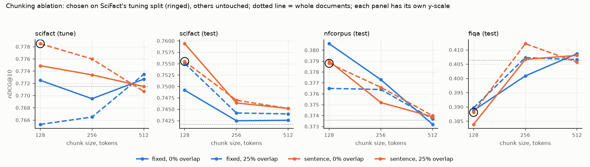
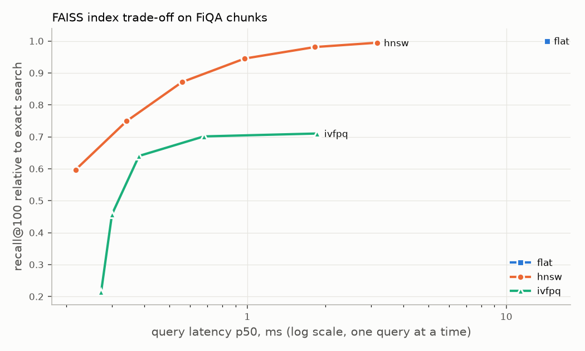
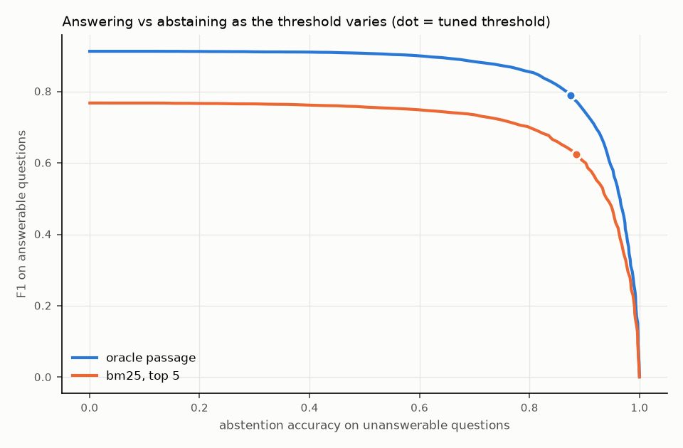

# KnowledgeQA-RAG

Retrieval-augmented question answering, built and measured one stage at a time. Given a question
and a document collection, the system has to find the passages that contain the answer, extract
the answer from them, and say "I don't know" when the collection does not contain one. Each of
those steps can fail on its own, and a single headline accuracy hides which one did. This
repository measures each step separately, against a BM25 baseline and against published reference
numbers, on public benchmarks, with every result reproducible from a clean clone. Everything runs
locally from pinned datasets and open weights: no API keys, no network access at inference.

## Pipeline

Documents are split into chunks (fixed 256-token windows with 64 tokens of overlap by default) and
indexed twice (SQuAD paragraphs, already passage-sized, are indexed whole): by BM25, a
Lucene-formula reimplementation scored exactly on the GPU, and by a dense bi-encoder,
`BAAI/bge-base-en-v1.5`, searched exactly with FAISS. A question retrieves chunks from either
index, or from both fused by reciprocal rank fusion, and each document takes the score of its best
chunk. Optionally, a cross-encoder (`BAAI/bge-reranker-v2-m3`) re-scores the top candidates. An
extractive reader, `deepset/roberta-base-squad2`, then reads the top 5 passages and returns the
best-scoring span, or abstains when that span does not beat the reader's own "no answer" score by a
threshold fitted on held-out data. Retrieval is evaluated on three BEIR subsets (SciFact, NFCorpus,
FiQA-2018) with nDCG@10, Recall@100 and MRR@10. The full pipeline is evaluated on SQuAD 2.0, with
EM and F1 on answerable questions reported separately from abstention accuracy on unanswerable
ones. Latency is reported as p50/p95 for each stage, with the corpus size stated.

## Results

Every number below is produced by a script in this repository. The tables between `table` markers
are written by `make report` from the CSVs in [`reports/`](reports/), so they cannot drift from the
runs. Nothing was tuned on an evaluation split: every choice was made on the BEIR tuning splits
(SciFact train, NFCorpus dev, FiQA dev) or on 10 held-out SQuAD articles.

### Retrieval

nDCG@10 on the BEIR test splits (300, 323 and 648 queries). "Whole documents" indexes each document
as a single unit, which is the setting published numbers use.

<!-- table:summary -->
| Retriever | Chunking | SciFact nDCG@10 | NFCorpus nDCG@10 | FiQA nDCG@10 |
|---|---|---|---|---|
| BM25 | whole documents | 0.678 | 0.320 | 0.235 |
| BM25 | fixed 256 / 64 | 0.684 | 0.316 | 0.232 |
| Dense (bge-base) | whole documents | 0.742 | 0.374 | 0.406 |
| Dense (bge-base) | fixed 256 / 64 | 0.744 | 0.376 | 0.407 |
| Hybrid (RRF) | whole documents | 0.740 | 0.371 | 0.370 |
| Hybrid (RRF) | fixed 256 / 64 | 0.741 | 0.374 | 0.356 |
| Dense + rerank (bge-v2-m3) | fixed 256 / 64 | 0.739 | 0.347 | 0.431 |
<!-- /table:summary -->

Published references for the whole-document rows, from the
[Pyserini BEIR reproductions](https://castorini.github.io/pyserini/2cr/beir.html): BM25 "flat"
0.679 / 0.322 / 0.236 and BGE-base 0.741 / 0.373 / 0.406 (SciFact / NFCorpus / FiQA).

- **Both baselines reproduce the published numbers.** Whole-document BM25 is within 0.003 of
  Pyserini's nDCG@10 and Recall@100 on every subset, and whole-document dense retrieval is within
  0.002. That checks qrels handling, document-id mapping and the metrics end to end. The metric
  code also agrees with pytrec_eval to 1e-15 (`scripts/crosscheck_metrics.py`).
- **BM25 does not win anywhere on BEIR.** bge-base beats it on all three subsets, at the default
  chunking by 0.06 nDCG@10 on SciFact and NFCorpus and by 0.18 on FiQA. Older or smaller encoders
  often lose to BM25 on SciFact and NFCorpus; this one does not. On SQuAD the order reverses (see
  below).
- **Hybrid fusion does not pay off with this encoder.** RRF ties dense retrieval on SciFact and
  NFCorpus (within 0.003) and is clearly worse on FiQA (0.356 vs 0.407). RRF weights both rankings
  equally, and BM25 is too weak a partner on FiQA.
- **Chunking barely moves first-stage retrieval** at the default 256-token windows: under 0.01
  nDCG@10 for BM25 and dense retrieval on every subset.

The full table at the default chunking follows, with BM25 first and with corpus size and
per-query latency. Latency answers each query on its own on one RTX 3090. Full tables are in
[`reports/results.csv`](reports/results.csv).

<!-- table:retrieval -->
| Retriever | Corpus | Documents | Chunks | nDCG@10 | Recall@100 | MRR@10 | p50 ms | p95 ms |
|---|---|---|---|---|---|---|---|---|
| BM25 | SciFact | 5,183 | 9,245 | 0.684 | 0.924 | 0.649 | 0.9 | 1.8 |
| BM25 | NFCorpus | 3,633 | 6,944 | 0.316 | 0.243 | 0.514 | 0.6 | 0.8 |
| BM25 | FiQA | 57,638 | 74,688 | 0.232 | 0.530 | 0.293 | 1.3 | 3.2 |
| Dense (bge-base) | SciFact | 5,183 | 9,245 | 0.744 | 0.966 | 0.709 | 16.3 | 21.4 |
| Dense (bge-base) | NFCorpus | 3,633 | 6,944 | 0.376 | 0.346 | 0.567 | 15.8 | 23.0 |
| Dense (bge-base) | FiQA | 57,638 | 74,688 | 0.407 | 0.739 | 0.487 | 17.9 | 26.0 |
| Hybrid (RRF) | SciFact | 5,183 | 9,245 | 0.741 | 0.977 | 0.703 | 19.1 | 23.1 |
| Hybrid (RRF) | NFCorpus | 3,633 | 6,944 | 0.374 | 0.344 | 0.569 | 18.2 | 24.6 |
| Hybrid (RRF) | FiQA | 57,638 | 74,688 | 0.356 | 0.709 | 0.430 | 20.2 | 27.7 |
| Dense + rerank (bge-v2-m3) | SciFact | 5,183 | 9,245 | 0.739 | 0.966 | 0.712 | 948.8 | 1211.3 |
| Dense + rerank (bge-v2-m3) | NFCorpus | 3,633 | 6,944 | 0.347 | 0.346 | 0.557 | 914.9 | 1004.7 |
| Dense + rerank (bge-v2-m3) | FiQA | 57,638 | 74,688 | 0.431 | 0.739 | 0.517 | 710.7 | 856.0 |
<!-- /table:retrieval -->

<details>
<summary>Whole-document rows</summary>

<!-- table:retrieval-whole -->
| Retriever | Corpus | Documents | Chunks | nDCG@10 | Recall@100 | MRR@10 | p50 ms | p95 ms |
|---|---|---|---|---|---|---|---|---|
| BM25 | SciFact | 5,183 | 5,183 | 0.678 | 0.925 | 0.643 | 0.9 | 1.3 |
| BM25 | NFCorpus | 3,633 | 3,633 | 0.320 | 0.246 | 0.521 | 0.6 | 1.0 |
| BM25 | FiQA | 57,638 | 57,638 | 0.235 | 0.541 | 0.295 | 1.2 | 3.4 |
| Dense (bge-base) | SciFact | 5,183 | 5,183 | 0.742 | 0.967 | 0.705 | 16.0 | 20.0 |
| Dense (bge-base) | NFCorpus | 3,633 | 3,633 | 0.374 | 0.337 | 0.563 | 15.6 | 21.2 |
| Dense (bge-base) | FiQA | 57,638 | 57,638 | 0.406 | 0.742 | 0.486 | 17.2 | 23.6 |
| Hybrid (RRF) | SciFact | 5,183 | 5,183 | 0.740 | 0.977 | 0.704 | 18.9 | 22.9 |
| Hybrid (RRF) | NFCorpus | 3,633 | 3,633 | 0.371 | 0.341 | 0.568 | 18.0 | 21.6 |
| Hybrid (RRF) | FiQA | 57,638 | 57,638 | 0.370 | 0.712 | 0.445 | 22.6 | 33.6 |
<!-- /table:retrieval-whole -->

</details>

### Reranking: what the cross-encoder buys and costs

bge-reranker-v2-m3 (568M parameters) re-scores every chunk of the dense retriever's top 100
documents. The first stage and the reranker were both chosen on the tuning splits, never on test
([`reports/selection.csv`](reports/selection.csv)). Latency is measured on a fixed sample of 100
queries per subset.

<!-- table:rerank -->
| Corpus | Pairs per query | nDCG@10 before | nDCG@10 after | Change | MRR@10 before | MRR@10 after | Retrieval p50 / p95 ms | Rerank p50 / p95 ms | End to end p50 / p95 ms |
|---|---|---|---|---|---|---|---|---|---|
| SciFact | 197 | 0.744 | 0.739 | -0.005 | 0.709 | 0.712 | 15 / 29 | 923 / 1227 | 949 / 1211 |
| NFCorpus | 208 | 0.376 | 0.347 | -0.030 | 0.567 | 0.557 | 15 / 28 | 900 / 985 | 915 / 1005 |
| FiQA | 181 | 0.407 | 0.431 | +0.024 | 0.487 | 0.517 | 16 / 17 | 693 / 840 | 711 / 856 |
<!-- /table:rerank -->

- **Reranking is not a free win.** It helps FiQA (+0.024 nDCG@10) and hurts NFCorpus (-0.030) and,
  slightly, SciFact (-0.005). The tuning splits predicted this pattern, and on them no candidate
  reranker beat dense retrieval alone on average.
- **It costs 43 to 60 times the first stage:** 0.7 to 0.9 s per query against about 15 ms, because
  each query sends about 200 (query, chunk) pairs through a 568M-parameter model.

### Chunking ablation: tuned on SciFact, transferred untouched

Dense retrieval over 13 chunkings: fixed windows and sentence-packed chunks of 128, 256 and 512
tokens, each with 0% and 25% overlap, plus whole documents (`make ablation`). **The configuration
was chosen on SciFact's tuning split alone; the NFCorpus and FiQA columns are untouched transfer.**



<!-- table:ablation -->
| Chunking | SciFact train (tuning) | SciFact test | NFCorpus test | FiQA test |
|---|---|---|---|---|
| whole documents | 0.771 | 0.742 | 0.374 | 0.406 |
| fixed 128 / 0 | 0.772 | 0.749 | 0.381 | 0.389 |
| fixed 128 / 32 | 0.765 | 0.755 | 0.377 | 0.390 |
| fixed 256 / 0 | 0.769 | 0.743 | 0.377 | 0.401 |
| fixed 256 / 64 (default) | 0.766 | 0.744 | 0.376 | 0.407 |
| fixed 512 / 0 | 0.773 | 0.743 | 0.373 | 0.409 |
| fixed 512 / 128 | 0.773 | 0.744 | 0.374 | 0.407 |
| sentence 128 / 0 | 0.775 | 0.759 | 0.379 | 0.384 |
| sentence 128 / 32 (selected) | 0.778 | 0.755 | 0.379 | 0.388 |
| sentence 256 / 0 | 0.773 | 0.746 | 0.375 | 0.407 |
| sentence 256 / 64 | 0.776 | 0.747 | 0.377 | 0.412 |
| sentence 512 / 0 | 0.771 | 0.745 | 0.374 | 0.408 |
| sentence 512 / 128 | 0.771 | 0.745 | 0.374 | 0.406 |
<!-- /table:ablation -->

- **The tuned choice transfers to SciFact test and NFCorpus, but not to FiQA.** Sentence chunks of
  128 tokens with 32 overlap add 0.011 nDCG@10 on SciFact test and 0.002 on NFCorpus over the
  a-priori default. They cost 0.019 on FiQA, where larger chunks are best. Abstracts reward small,
  focused chunks; forum answers need their context. The default therefore stays fixed 256 / 64.
- **The effect is real but bounded:** chunking moves nDCG@10 by 0.007 to 0.028 within a corpus.
  That is smaller than the gap between BM25 and dense retrieval, but comparable to the reranker's
  effect.

### Index trade-off: exact vs approximate search

The test is dense search over FiQA's 74,650 non-empty chunk embeddings (768-d), one query at a time
on two CPU threads (`make study`). Recall is the overlap of each index's top 100 with exact search,
and nDCG@10 shows what that loss costs downstream.



<!-- table:index -->
| Index | Setting | Recall vs exact | nDCG@10 | p50 ms | p95 ms | Build s | Memory MB |
|---|---|---|---|---|---|---|---|
| flat | exact | 1.000 | 0.407 | 14.36 | 17.51 | 0.2 | 229.3 |
| hnsw | efSearch=16 | 0.597 | 0.384 | 0.22 | 0.34 | 65.9 | 249.6 |
| hnsw | efSearch=32 | 0.749 | 0.397 | 0.34 | 0.54 | 65.9 | 249.6 |
| hnsw | efSearch=64 | 0.871 | 0.402 | 0.56 | 0.77 | 65.9 | 249.6 |
| hnsw | efSearch=128 | 0.945 | 0.405 | 0.98 | 1.31 | 65.9 | 249.6 |
| hnsw | efSearch=256 | 0.981 | 0.407 | 1.82 | 2.74 | 65.9 | 249.6 |
| hnsw | efSearch=512 | 0.995 | 0.407 | 3.17 | 4.46 | 65.9 | 249.6 |
| ivfpq | nprobe=1 | 0.214 | 0.221 | 0.27 | 0.36 | 11.6 | 11.7 |
| ivfpq | nprobe=4 | 0.457 | 0.297 | 0.30 | 0.40 | 11.6 | 11.7 |
| ivfpq | nprobe=16 | 0.640 | 0.353 | 0.38 | 0.52 | 11.6 | 11.7 |
| ivfpq | nprobe=64 | 0.701 | 0.369 | 0.68 | 0.82 | 11.6 | 11.7 |
| ivfpq | nprobe=256 | 0.710 | 0.372 | 1.86 | 2.25 | 11.6 | 11.7 |
<!-- /table:index -->

- **Exact search is affordable at this scale:** 14 ms per query on two CPU threads, less on the
  GPU. Every reported result therefore uses exact search.
- **HNSW is the approximate index to reach for:** at efSearch 128 it keeps 94.5% of the exact top
  100 and loses 0.002 nDCG@10 at under 1 ms, for 9% more memory.
- **IVF-PQ trades accuracy for memory:** it is 20 times smaller (11.7 MB vs 229 MB), but its recall
  stops near 0.71 however many lists are probed, costing 0.036 nDCG@10.

### End to end: retrieve, read, abstain (SQuAD 2.0)

The reader answers from the top 5 paragraphs of a corpus of all 20,233 SQuAD 2.0 paragraphs, so the
1,204 dev paragraphs sit among 19,029 train distractors. The oracle row reads only the gold
paragraph, so the gap between it and a retrieval row is the error caused by retrieval. The reranked
rows re-score each first stage's top 20. The abstention threshold is fitted per row on 10 dev
articles held out whole ("Tuning-article F1" is the official SQuAD F1 there). Every other number is
on the remaining 25 articles: 4,260 answerable and 4,189 unanswerable questions (`make eval`,
[`reports/e2e_results.csv`](reports/e2e_results.csv)).

<!-- table:e2e -->
| Retrieval | Gold passage in top 5 | Answerable EM | Answerable F1 | Abstention accuracy | Tuning-article F1 | Retrieval p50 / p95 ms | Rerank p50 / p95 ms | Reader p50 / p95 ms | End to end p50 / p95 ms |
|---|---|---|---|---|---|---|---|---|---|
| Oracle passage | - | 0.741 | 0.790 | 0.874 | 0.832 | - | - | 17 / 33 | 17 / 33 |
| BM25 | 0.866 | 0.585 | 0.625 | 0.885 | 0.771 | 1 / 3 | - | 24 / 38 | 25 / 41 |
| Dense (bge-base) | 0.773 | 0.516 | 0.553 | 0.901 | 0.746 | 17 / 30 | - | 24 / 38 | 42 / 66 |
| BM25 + rerank (bge-v2-m3) | 0.918 | 0.575 | 0.613 | 0.888 | 0.766 | 1 / 3 | 132 / 160 | 23 / 37 | 158 / 188 |
| Dense + rerank (bge-v2-m3) | 0.867 | 0.560 | 0.601 | 0.874 | 0.753 | 16 / 29 | 117 / 153 | 23 / 39 | 161 / 200 |
<!-- /table:e2e -->



- **The oracle gap: 0.790 F1 on answerable questions with the gold paragraph, 0.625 with the best
  pipeline, so retrieval costs 0.165 F1.** 11.9% of answerable questions (506 of 4,260) never get
  their gold paragraph into BM25's top 5, and those score 0.03 F1.
- **BM25 beats dense retrieval on SQuAD** (gold paragraph in the top 5 for 86.6% vs 77.3% of
  questions, 0.625 vs 0.553 F1), the reverse of BEIR. SQuAD questions were written while reading
  the paragraph and reuse its words, which favours exact term matching.
- **Reranking improves retrieval but not answers.** It lifts BM25's gold-in-top-5 rate from 0.866
  to 0.918, yet answerable F1 falls from 0.625 to 0.613. The same happens on the tuning articles,
  so the served pipeline does not rerank. After dense retrieval it does help (0.553 to 0.601 F1),
  but not enough to catch BM25 alone.
- **Abstention is a dial, not a constant.** The curve trades answerable F1 against abstention
  accuracy smoothly, and an application that fears wrong answers more than missing ones can move
  along it.
- **The reader is validated in isolation.** With gold paragraphs on the full dev set and threshold
  0, it scores 79.81 EM / 82.80 F1 on the official blended metric, against 79.93 / 82.95 on its
  model card ([`reports/reader_check.csv`](reports/reader_check.csv)).

### Service latency

`scripts/benchmark_latency.py` (`make benchmark`) sends 20 warm-up questions (discarded) and then
300 timed SQuAD questions, one at a time, through the HTTP service's handler in process. End to end
is the full request, including validation and JSON encoding. Corpus: 20,233 paragraphs. Hardware:
one NVIDIA RTX 3090, Intel Core i7-4790K, two CPU threads for the process. The served pipeline is
BM25 plus the reader on the top 5. The reranked variant (top 20 re-scored) is timed for comparison.
The results are in [`reports/latency.csv`](reports/latency.csv).

<!-- table:latency -->
| Pipeline | Stage | p50 ms | p95 ms | Mean ms | Queries |
|---|---|---|---|---|---|
| BM25 (served) | Retrieval | 1.2 | 3.0 | 1.4 | 300 |
| BM25 (served) | Reading | 18.7 | 32.0 | 20.7 | 300 |
| BM25 (served) | End to end (HTTP request) | 22.0 | 36.6 | 24.2 | 300 |
| BM25 + rerank (bge-v2-m3) | Retrieval | 1.3 | 1.9 | 1.4 | 300 |
| BM25 + rerank (bge-v2-m3) | Reranking | 127.5 | 151.5 | 125.0 | 300 |
| BM25 + rerank (bge-v2-m3) | Reading | 19.0 | 25.0 | 20.9 | 300 |
| BM25 + rerank (bge-v2-m3) | End to end (HTTP request) | 150.8 | 175.7 | 149.0 | 300 |
<!-- /table:latency -->

Retrieval over 20k paragraphs takes under 2 ms at p50. The reader dominates the served pipeline.
The reranker would add about 130 ms, more than five times the rest of the pipeline, for answers
that are no better.

### Corpora

Lengths are in bert-base-uncased WordPiece tokens (title + text). Chunks are for the default
configuration; `make stats` writes the full grid to
[`reports/corpus_stats.csv`](reports/corpus_stats.csv).

| Corpus   | Documents | Mean tokens | Median | p99 | Max   | Chunks | Chunks per doc |
|----------|-----------|-------------|--------|-----|-------|--------|----------------|
| SciFact  | 5,183     | 335         | 314    | 759 | 1,937 | 9,245  | 1.78           |
| NFCorpus | 3,633     | 355         | 355    | 689 | 2,375 | 6,944  | 1.91           |
| FiQA     | 57,638    | 175         | 118    | 836 | 3,597 | 74,688 | 1.30           |

FiQA includes 38 empty documents that the official qrels still judge relevant. They are kept so
the corpus and qrels match the official release (see [DECISIONS.md](DECISIONS.md)).

## Reproducing from a clean clone

Requirements: Linux, [uv](https://docs.astral.sh/uv/), an NVIDIA GPU (developed on a 24 GB RTX 3090)
and a driver that supports CUDA 12, and about 9 GB of free disk (4.2 GB of model weights, 55 MB of
data, the rest caches).

```bash
git clone https://github.com/HajibagheriLabs/KnowledgeQA-RAG.git
cd KnowledgeQA-RAG
make setup      # .venv with Python 3.11 and pinned dependencies (PyTorch from the CUDA 12.6 index)
make data       # datasets and model weights at pinned revisions, hash-verified, into data/
make lint && make test
make eval       # BEIR retrieval, reranking and SQuAD end to end -> reports/*.csv (about 80 min on an RTX 3090)
make benchmark  # service latency -> reports/latency.csv
make report     # reports/results.csv, and refresh every table in this README
```

The remaining experiments have their own targets:

```bash
make select     # first stage and reranker on the tuning splits -> reports/selection.csv (about 35 min)
make ablation   # chunking ablation -> reports/ablations.csv and .png (about 25 min)
make study      # exact vs HNSW vs IVF-PQ on FiQA -> reports/index_study.csv and .png
make stats      # corpus sizes and token lengths -> reports/corpus_stats.csv
```

Every metric is deterministic. Rerunning on the same machine reproduces every metric exactly, and
the TREC run files byte for byte. On a different GPU, fp16 encoder arithmetic may move scores in
the last digits. Latencies depend on the hardware.

Each run writes its exact config and TREC run files to a timestamped `runs/` directory and logs
to a local MLflow store (`mlflow ui --backend-store-uri sqlite:///mlruns/mlflow.db`). To
recompute a run's metrics with pytrec_eval:

```bash
uv pip install --python .venv/bin/python -e ".[crosscheck]"
.venv/bin/python scripts/crosscheck_metrics.py runs/<timestamp>-retrieval
```

`make train` is a no-op: no stage is trained here. The only fitted parameter, the abstention
threshold, is fitted inside `make eval`.

## Service

```bash
make serve      # http://127.0.0.1:8000, after make data and make eval (or with the committed reports/)
```

The service needs the corpus and weights from `make data`. It reads its abstention threshold from
the committed `reports/e2e_results.csv`. In Docker, `data/` is mounted rather than copied into the
image:

```bash
docker build -t knowledgeqa .
docker run --gpus all -p 8000:8000 -v "$PWD/data:/app/data" --user "$(id -u):$(id -g)" knowledgeqa
```

```bash
curl -s localhost:8000/health
curl -s -X POST localhost:8000/query -H 'content-type: application/json' \
  -d '{"question": "Who was the Norse leader who founded Normandy?"}'
```

The query response contains:

- `answer`: the extracted span, or `null` with `abstained: true`.
- `margin`: the reader's margin over its no-answer score.
- `chunks`: the five paragraphs read, each with its id, title, text, retrieval score and (when
  reranking is enabled) rerank score.
- `source`: the index in `chunks` of the paragraph the answer came from.
- `timings_ms`: the time spent in each stage.

There is no authentication, persistence or streaming.

## Limitations

- **The corpora are small.** They range from 3.6k to 58k documents, and 20k paragraphs for SQuAD.
  At this size exact search is cheap and an index fits in GPU memory. The latency figures do not
  extrapolate to millions of documents, where an approximate index (HNSW, per the index study)
  and its recall loss become part of the system.
- **The domains are narrow and English only:** scientific claims, nutrition and medicine, finance
  forums and Wikipedia. The ablation shows that a chunking tuned on one domain need not transfer
  to another, and the same applies to every other choice here.
- **SQuAD flatters lexical retrieval and extractive reading.** Its questions were written while
  looking at the paragraph and its answers are spans. Real users' questions would likely narrow
  BM25's lead, and questions that need synthesis across passages, yes/no answers or reasoning are
  out of reach for an extractive reader.
- **Pretraining contamination is possible.** The reader was fine-tuned on SQuAD 2.0 train, and the
  encoders were trained on web data that may include Wikipedia and the BEIR sources. This affects
  absolute numbers more than the comparisons between pipelines.
- **The threshold rests on little data.** It is fitted on 10 articles (3,424 questions). A
  different held-out set would move it somewhat, and no confidence intervals are reported for any
  metric.
- **The service is a single process on one GPU, answering one request at a time.** The corpus is
  fixed at start-up, and nothing was measured under concurrent load.

## Layout

```
configs/default.yaml     every path, revision and hyperparameter
scripts/                 runnable entry points: download, experiments, benchmark, report
src/knowledgeqa/         ingest, chunking, sparse, dense, rerank, reader, evaluate, pipeline, serve
tests/                   small pytest suite: split leakage, data contracts, metrics, config
reports/                 committed result tables and figures
Dockerfile               the query service
DECISIONS.md             every non-obvious choice and why
```

## License

MIT
